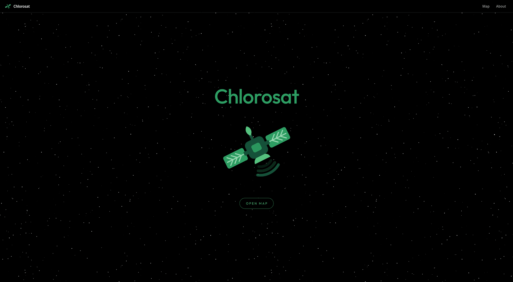
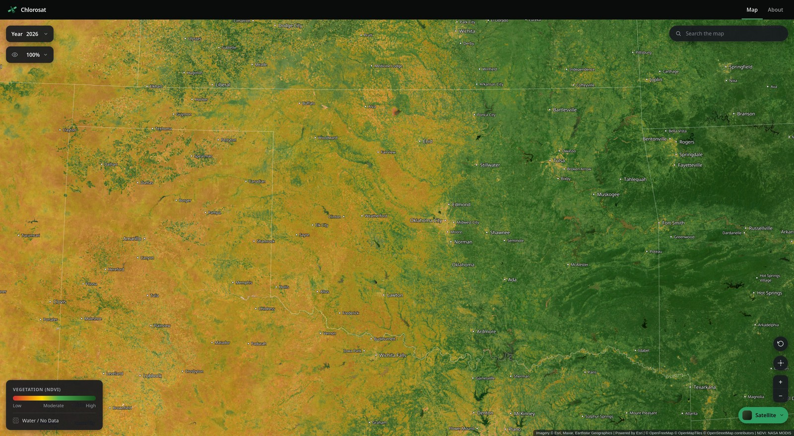

# Chlorosat

Chlorosat shows **how green any place on Earth is**, using NASA satellite vegetation data (MODIS NDVI) on an interactive 3D globe. It's built for people who aren't map experts: policymakers, environmental activists and scientists, and homebuyers.

**Live site:** [chlorosat.com](https://chlorosat.com) · **Tasks:** [docs/BACKLOG.md](docs/BACKLOG.md) · **Team:** Group E, CS3203-001

## Contents

- [Screenshots](#screenshots)
- [What works](#what-works)
- [Not implemented yet](#not-implemented-yet)
- [How the live site works](#how-the-live-site-works)
- [Setup](#setup)
- [Contributing](#contributing)
- [Project structure](#project-structure)
- [Docs](#docs)
- [Future pipeline](#future-pipeline)

## Screenshots

| Home page (`/`) | Map page (`/map/`) |
|---|---|
|  |  |

*Data: NASA GIBS (MODIS NDVI), Esri World Imagery, OpenFreeMap/OpenMapTiles, © OpenStreetMap contributors.*

## What works

- Worldwide 3D globe (MapLibre) with no regional limits.
- **Vegetation (NDVI)** for each year from 2019 to 2026: NASA's MODIS Terra 16-day composite from mid-August, about 250 m per pixel, shown on a continuous low-to-high vegetation color scale. Water is hidden.
- **Satellite view:** Esri World Imagery. For each year it uses the Esri Wayback release closest to mid-August, and the credit line shows when the photos on screen were actually taken.
- **Map view:** a street map drawn by the app from OpenFreeMap vector tiles (OpenStreetMap data).
- Place names and borders drawn by the app in both views.
- Controls for year, vegetation visibility, opacity and view (Satellite/Map).
- Place search with recent searches, your location, zoom, recenter and north reset.
- Home, Map and About pages that work on phones and desktops.
- Static build with automatic deployment on every merge to `main`.

## Not implemented yet

- Comparing two years or showing gained/lost vegetation.
- Statistics for a place, region or selected area.
- Visible-light vegetation detection, or a method selector.
- Downloading maps or statistics.
- Sharing the current map view by URL.
- Using the Python pipeline on the live site.

The year control shows **one year at a time**. Changing the year is not a comparison: it swaps the NASA layer and, where possible, the historical satellite imagery.

## How the live site works

The site is a Next.js **static export**: plain HTML, CSS and JavaScript in `web/out/`, served by nginx. No app code or satellite processing runs on the server. Your browser fetches all map data directly from these public services:

| Service | What the browser gets | Used for |
|---|---|---|
| [NASA GIBS](https://www.earthdata.nasa.gov/engage/open-data-services-software/earthdata-developer-portal/gibs-api) | `MODIS_Terra_L3_NDVI_16Day` tiles + the `MODIS_NDVI` color legend | Vegetation layer |
| NASA GIBS | `OSM_Land_Water_Map` tiles | Backup water mask (if the OpenFreeMap tile is unavailable) |
| [Esri World Imagery](https://www.arcgis.com/home/item.html?id=10df2279f9684e4a9f6a7f08febac2a9) | Satellite tiles (keyed endpoint if an API key is set, otherwise the keyless one) | Satellite view |
| [Esri World Imagery Wayback](https://livingatlas.arcgis.com/wayback/) | Release list, past imagery tiles, and photo-date metadata | Satellite imagery for the selected year + its credit line |
| [OpenFreeMap](https://openfreemap.org) | Vector tiles (OpenMapTiles schema, © OpenStreetMap contributors) + fonts | Map view, place names, borders, exact water outlines |
| [Photon](https://photon.komoot.io) (komoot) | Place search results | Search bar |
| Your browser's location feature | Your position, only if you allow it | "My location" button (no outside service) |

How the vegetation layer is made:
1. The browser downloads NASA's ready-made NDVI tiles. Chlorosat does **not** calculate NDVI from raw satellite bands on the live site.
2. Each pixel's NDVI value is read from NASA's published legend, then shown in Chlorosat's own color scale. Water pixels are hidden.
3. Raw NASA tiles are kept in the browser's Cache Storage (on HTTPS or localhost), so revisits load faster. Recolored tiles are rebuilt in memory after a full refresh.
4. If NASA can't be reached, the vegetation layer stays empty. The site never fills in made-up data.

More detail: [docs/ARCHITECTURE.md](docs/ARCHITECTURE.md) and the diagrams in [docs/UML.md](docs/UML.md).

## Setup

**You need:** [Git](https://git-scm.com) and [Node.js 22 or newer](https://nodejs.org). No API keys are required. The map loads its data from the services above, so you need an internet connection.

**1. Get the code**

```bash
git clone https://github.com/adamweaver/Chlorosat.git
cd Chlorosat
```

**2. Run the website** (from the repo root)

```bash
cd web
npm ci            # install the exact package versions from package-lock.json
npm run dev       # start the dev server
```

Then open http://localhost:3000/ (home), http://localhost:3000/map/ (globe) or http://localhost:3000/about/.

**3. Check your changes before opening a PR** (in `web/`)

```bash
npm run lint      # code style
npm run build     # static site -> web/out/ (this is what gets deployed)
python3 -m http.server -d out 8000   # optional: preview the built site at http://localhost:8000
```

More detail, including an optional Esri API key: [docs/SETUP.md](docs/SETUP.md).
The Python pipeline has its own setup; see [Future pipeline](#future-pipeline).

## Contributing

1. **Pick a task** from [docs/BACKLOG.md](docs/BACKLOG.md) and tell the team you're taking it.
2. **Branch** from an up-to-date `main`:
   ```bash
   git switch main && git pull
   git switch -c feature/<name>      # or fix/<name>, docs/<name>
   ```
3. **Make one focused change**, committing in small steps with short, clear messages (`Add year label`, not `stuff`).
4. **Run the checks** from [Setup](#setup) step 3 for the part you changed.
5. **Open a pull request** into `main`. The PR template asks what changed, how to test it, and whether AI helped.
6. **Merge** after CI passes and one teammate approves. The site then deploys automatically. Delete your branch and move the task to **Done** in the backlog with the PR number.

Ask the team first before adding a dependency or changing the architecture, data sources or deployment.
Using AI tools? Follow [AGENTS.md](AGENTS.md) and tag AI-written code with its `[AI]` comment block.

**This repo is public.** Never commit passwords, tokens, private keys, `.env` files, raw satellite data or the server's address. See [AGENTS.md → Security & secrets](AGENTS.md#security--secrets).

## Project structure

| Path | Purpose |
|---|---|
| `web/src/app/` | Next.js pages (`/`, `/map/`, `/about/`) and the shared layout |
| `web/src/components/map/` | The globe, its controls and map-specific styles |
| `web/src/components/home/` | Home page art (satellite, stars) and styles |
| `web/src/components/Header.js` | Header shown on every page |
| `web/src/lib/map/` | MapLibre engine, remote data, colors and labels |
| `web/src/styles/` | Global design tokens, resets and MapLibre overrides |
| `web/public/` | Static files copied into the build as-is |
| `pipeline/` | Future offline processing package; not used by the site |
| `deploy/` | nginx config and manual deploy script (server side: Adam only) |
| `.github/` | CI and deploy workflows; PR and issue templates |
| `docs/` | Architecture, UML, setup, deployment, backlog, principles; research and sprint plans |
| `branding/` | Logo and color palette |
| `AGENTS.md` | Rules for AI coding tools (`CLAUDE.md` points to it) |

## Docs

- [ARCHITECTURE.md](docs/ARCHITECTURE.md): how the site fits together and why
- [UML.md](docs/UML.md): diagrams of the components and data flow
- [SETUP.md](docs/SETUP.md): full developer setup and common problems
- [BACKLOG.md](docs/BACKLOG.md): every task with its owner, acceptance criteria and status; milestones
- [PRINCIPLES.md](docs/PRINCIPLES.md): goals, audiences and design rules
- [DEPLOYMENT.md](docs/DEPLOYMENT.md): how merges reach the server, and the security rules
- [docs/research/](docs/research/) and [docs/scrum/](docs/scrum/): earlier research and sprint plans (historical; some describe the retired Leaflet design)

## Future pipeline

`pipeline/` holds a planned offline Python workflow that would make Chlorosat's own vegetation layers from raw Sentinel-2 satellite bands. **It is not connected to the live website.**

- **Works today:** one command. You give it red (B04) and near-infrared (B08) Sentinel-2 GeoTIFF files that you downloaded yourself; it calculates NDVI for a region from `pipeline/regions.toml` (only `okc-norman` so far), colors it, and writes a PNG + `manifest.json` into `web/public/data/`. The live site doesn't read that folder.
- **Not implemented:** downloading scenes, cloud masking, seasonal composites, visible-light detection, statistics, change maps, multi-year runs, and any connection to the globe.

Exact status: [pipeline/README.md](pipeline/README.md).

To work on it, install [uv](https://docs.astral.sh/uv/getting-started/installation/) (it installs Python 3.12 for you), then from the repo root:

```bash
cd pipeline
uv sync           # install Python + packages
uv run ruff check # code style
uv run pytest     # tests
uv run chlorosat ndvi --region okc-norman --year 2024 --red B04.tif --nir B08.tif   # the one working command
```

Add `--offset 1000` for Sentinel-2 L2A scenes from 2022 on. Raw satellite files belong in `pipeline/data/` and must never be committed.

---

Group E — CS3203-001 Software Engineering: Adam, Carter, David, Kevin and Lucas.
