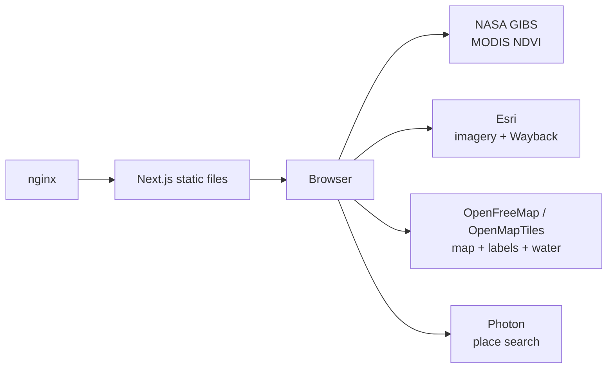
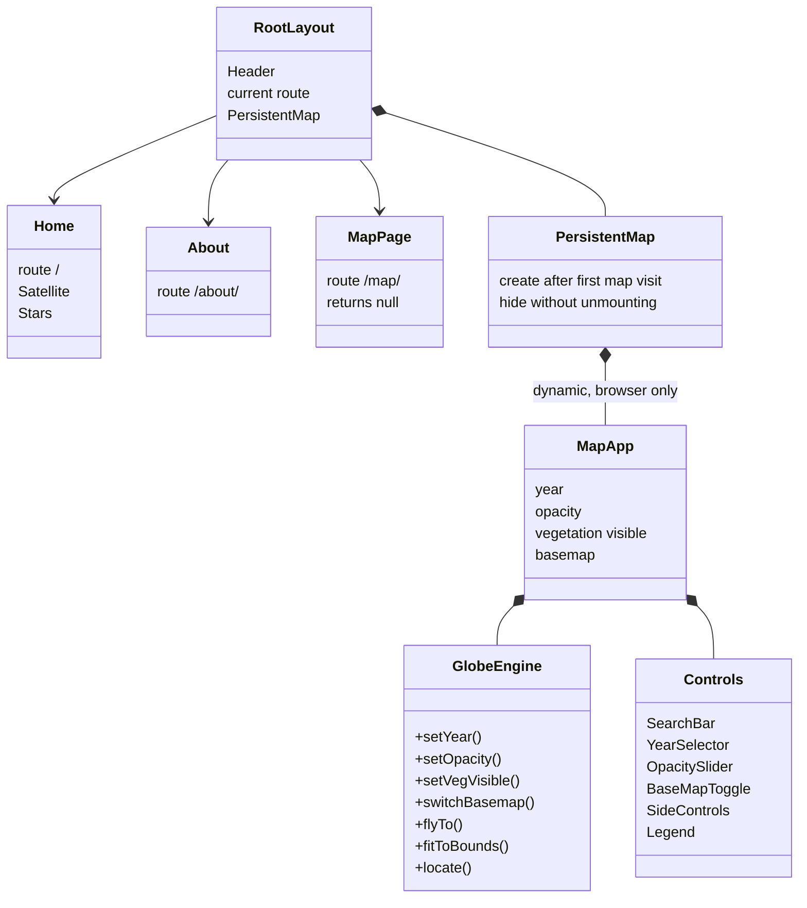
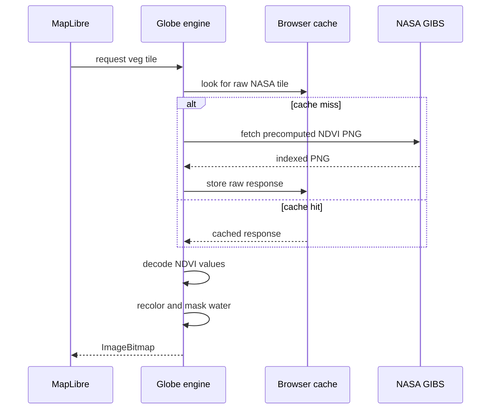
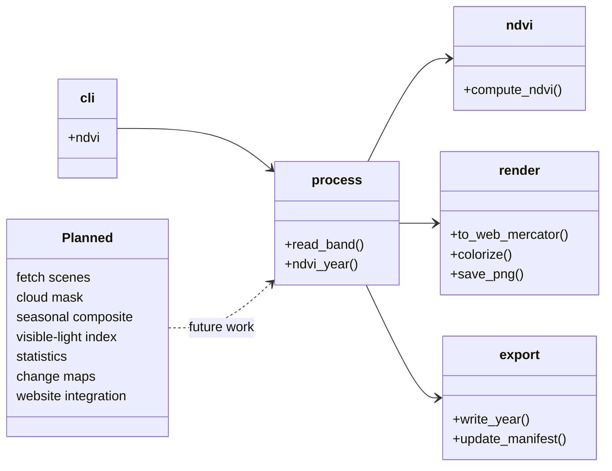

# UML diagrams

These diagrams describe the current runtime. The future Python pipeline is
shown separately because the live website does not call it or read its output.

GitHub renders Mermaid diagrams. In an editor that does not, paste a block
into [mermaid.live](https://mermaid.live).

## Live system

nginx serves files only. All remote-data requests and NDVI display processing
happen in the browser.

## Website components

`MapPage` is intentionally empty: its presence creates the `/map/` route.
`PersistentMap`, mounted by `RootLayout`, owns the visible map.

## Tile processing

NASA calculates NDVI. Chlorosat transforms the supplied values for display.
Raw responses persist across refreshes on secure origins; transformed
bitmaps are cached only in memory.

## Future pipeline

Only the solid local-file NDVI chain is implemented. The planned features do
not run and the pipeline has no connection to the live globe.
